# Benchmark results, -O2

## Conditions

These charts are this run. Another optimization level is another directory, and a bar there is not this bar.

| | |
| --- | --- |
| CPU | AMD EPYC 9V45 96-Core Processor |
| Hardware threads | 4 |
| Frequency the benchmark library reported | 4422 MHz |
| Caches | L1 data 48 KiB, shared by 2; L1 instruction 32 KiB, shared by 2; L2 unified 1 MiB, shared by 2; L3 unified 32 MiB, shared by 4 |
| Frequency scaling | disabled |
| Compiler | g++-16 (Ubuntu 16-20260322-1ubuntu1) 16.0.1 20260322 (experimental) [trunk r16-8246-g569ace1fa50] (`/usr/bin/g++-16`) |
| Flags on `benchmark_work.cpp` | `-O2 -DNDEBUG -std=c++26 -Wall -Wextra -Wpedantic -Werror -freflection -fmodules-ts` |
| Link-time optimization | absent. The benchmark target sets `INTERPROCEDURAL_OPTIMIZATION` off, so the timed bodies stay out of the translation unit that runs the loop. |
| Google Benchmark | 1.9.1, library itself built as debug |
| When | 2026-11-19T18:35:51+00:00 |

Each bar is the CPU time of the named operation. A cycle bar includes construction, the calls, and destruction. One pass walks 12288 objects.

## Cycle

Construct, draw, compute the area, and destroy.

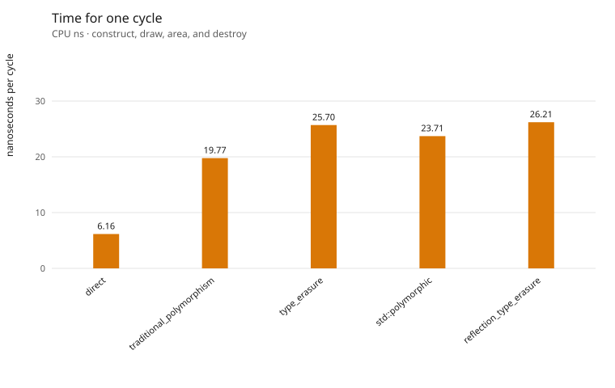

The chart below leaves out direct. 100% is the fastest of the four, and the others are that time scaled up.

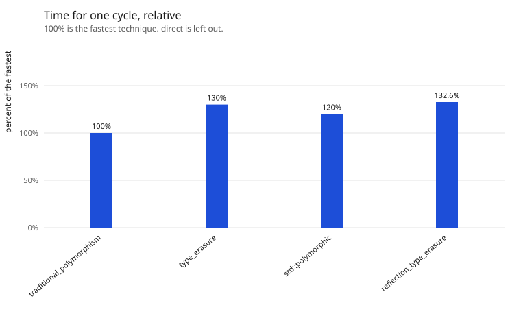

## Cycle, 5 calls

Construct, alternate draw() and area() five times (three draws and two areas), and destroy.

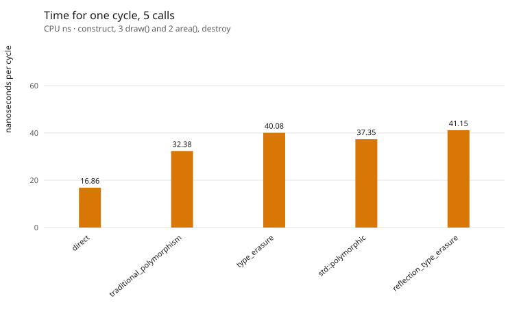

The chart below leaves out direct. 100% is the fastest of the four, and the others are that time scaled up.

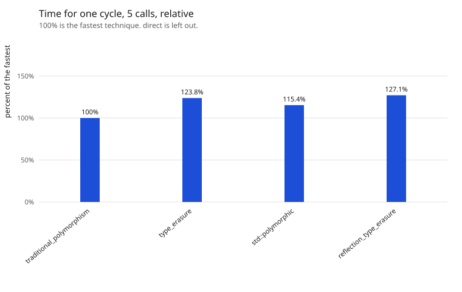

## Cycle, 50 calls

Construct, alternate draw() and area() fifty times, and destroy.

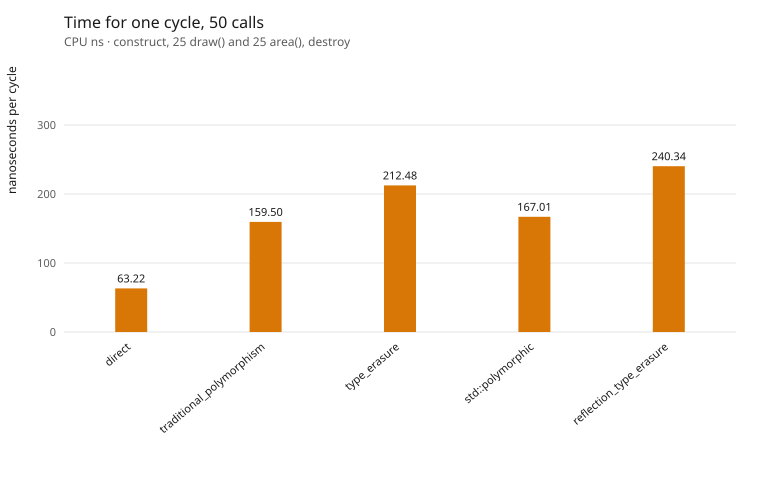

The chart below leaves out direct. 100% is the fastest of the four, and the others are that time scaled up.

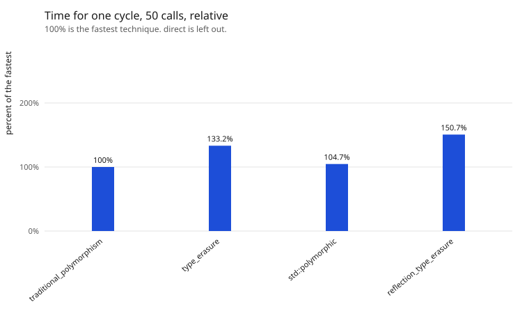

## Cycle, 500 calls

Construct, alternate draw() and area() five hundred times, and destroy.

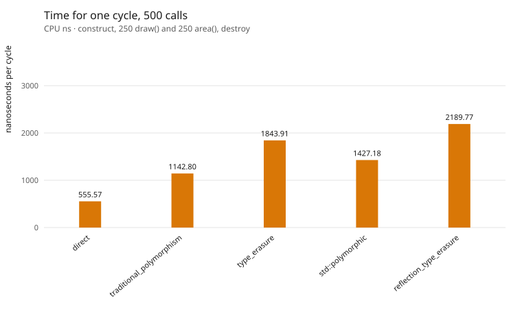

The chart below leaves out direct. 100% is the fastest of the four, and the others are that time scaled up.

## Cycle, 5000 calls

Construct, alternate draw() and area() five thousand times, and destroy.

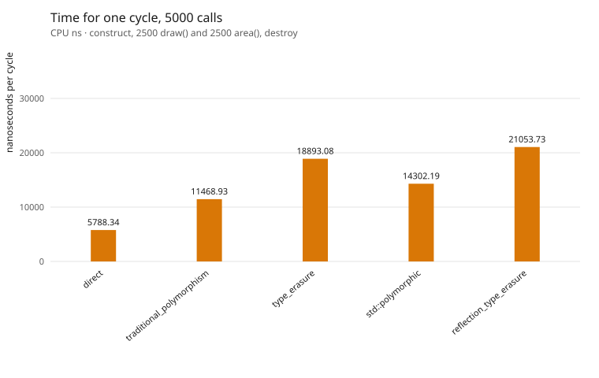

The chart below leaves out direct. 100% is the fastest of the four, and the others are that time scaled up.

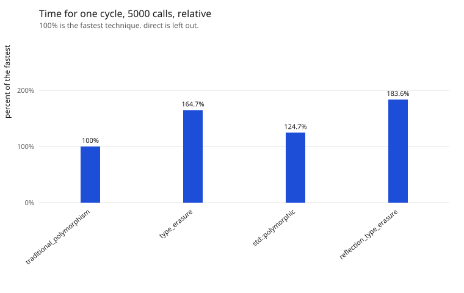

## Draw

One draw() call. The string fits in the small buffer.

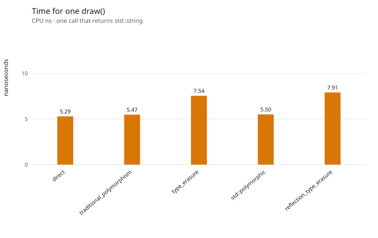

The chart below leaves out direct. 100% is the fastest of the four, and the others are that time scaled up.

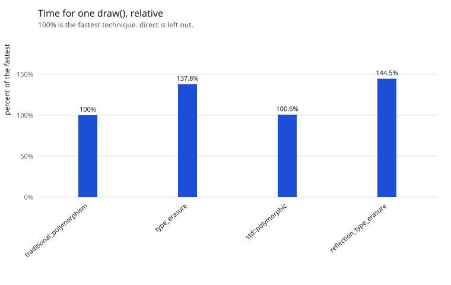

## Area

One area() call. traditional_polymorphism, type_erasure, and std::polymorphic use a local base because the shapes hierarchy has no numeric method.

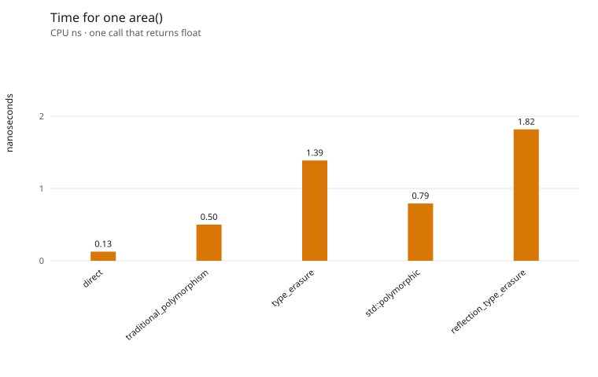

The chart below leaves out direct. 100% is the fastest of the four, and the others are that time scaled up.

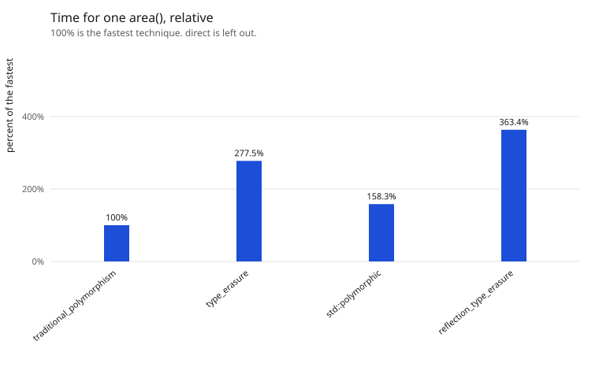

## Copy

Copy one owning object. traditional_polymorphism clones through a virtual function because unique_ptr does not copy the derived object.

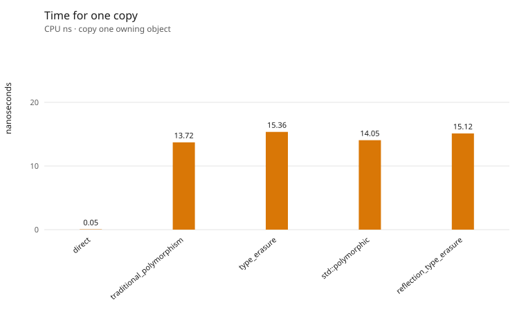

The chart below leaves out direct. 100% is the fastest of the four, and the others are that time scaled up.

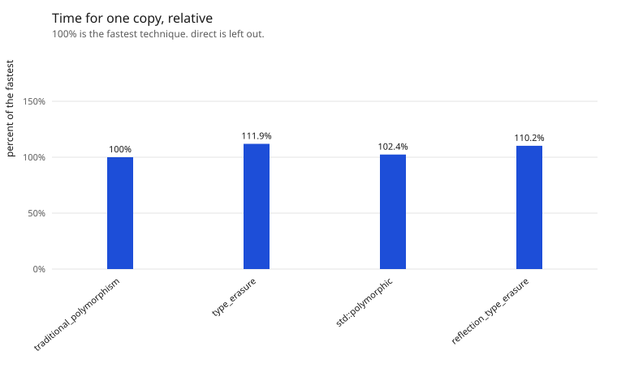

## Build

Construct one object. direct stores it in the array; the others allocate on the heap.

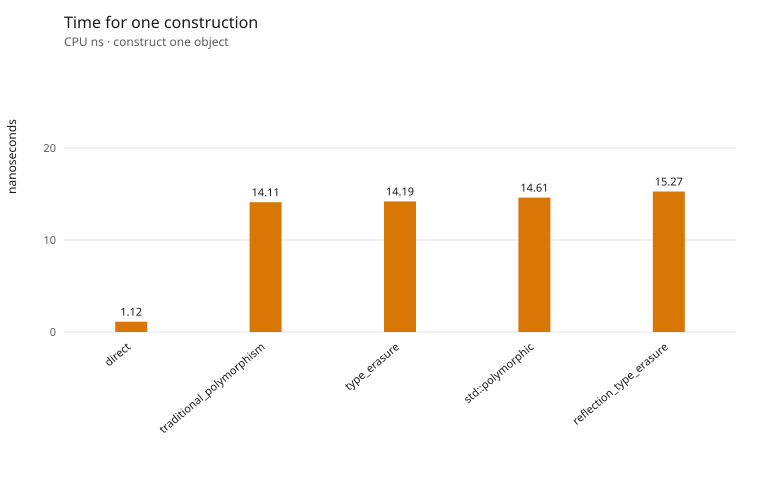

The chart below leaves out direct. 100% is the fastest of the four, and the others are that time scaled up.

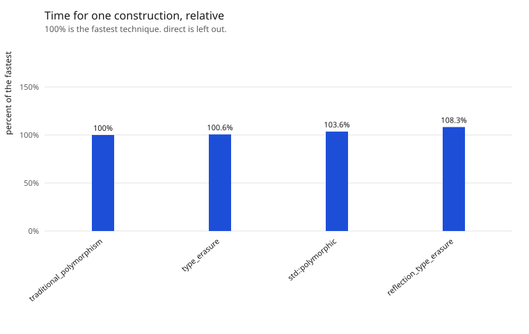
