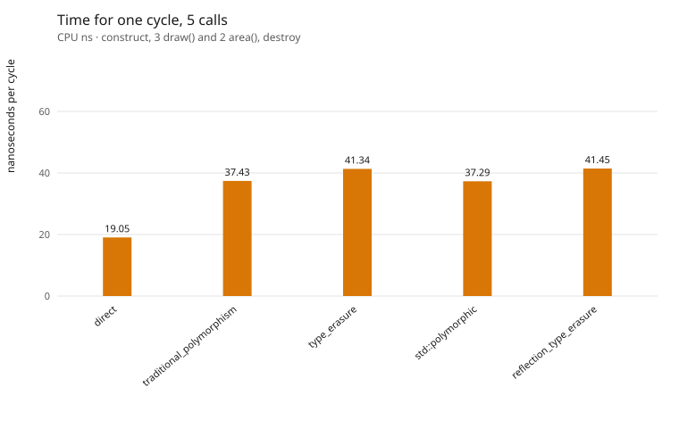
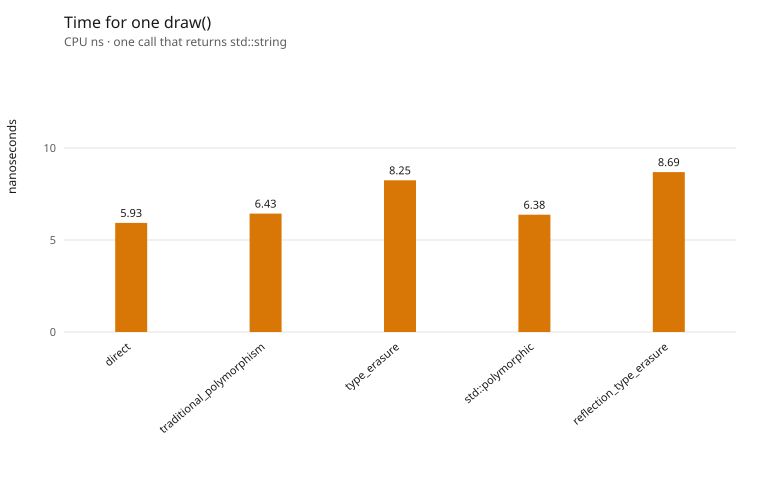
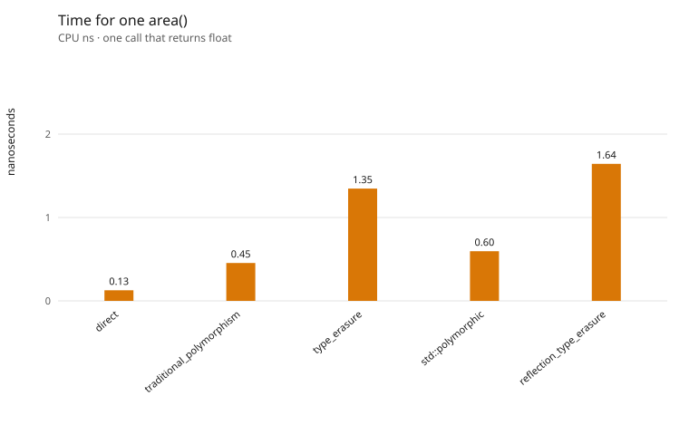

# Benchmark results

Measured on `c1a8b6c54d93` at 2026-11-18T21:56:32+00:00 with the `gcc16-benchmarks` preset. CPU frequency scaling was disabled.

Each bar is the CPU time of the named operation. A cycle bar includes construction, the calls, and destruction. One pass walks 12288 objects.

## Cycle

Construct, draw, compute the area, and destroy.

## Cycle, 5 calls

Construct, alternate draw() and area() five times (three draws and two areas), and destroy.

## Cycle, 50 calls

Construct, alternate draw() and area() fifty times, and destroy.

## Cycle, 500 calls

Construct, alternate draw() and area() five hundred times, and destroy.

## Cycle, 5000 calls

Construct, alternate draw() and area() five thousand times, and destroy.

## Draw

One draw() call. The string fits in the small buffer.

## Area

One area() call. traditional_polymorphism, type_erasure, and std::polymorphic use a local base because the shapes hierarchy has no numeric method.

## Copy

Copy one owning object. traditional_polymorphism clones through a virtual function because unique_ptr does not copy the derived object.

## Build

Construct one object. direct stores it in the array; the others allocate on the heap.

