# Benchmark results

Measured on `d2288f6610bf` at 2026-11-18T22:10:07+00:00 with the `gcc16-benchmarks` preset. CPU frequency scaling was disabled.

Each bar is the CPU time of the named operation. A cycle bar includes construction, the calls, and destruction. One pass walks 12288 objects.

## Cycle

Construct, draw, compute the area, and destroy.

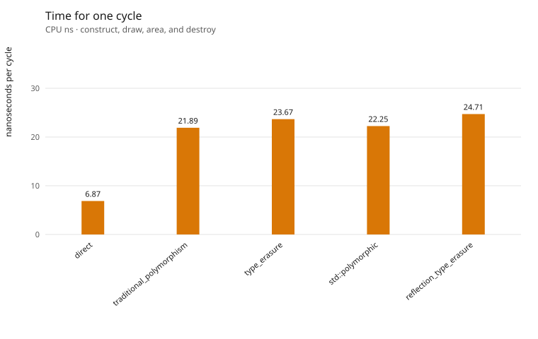

The chart below leaves out direct. 100% is the fastest of the four, and the others are that time scaled up.

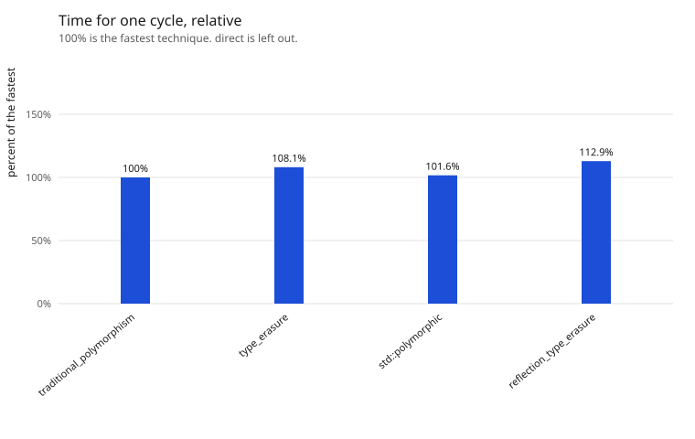

## Cycle, 5 calls

Construct, alternate draw() and area() five times (three draws and two areas), and destroy.

The chart below leaves out direct. 100% is the fastest of the four, and the others are that time scaled up.

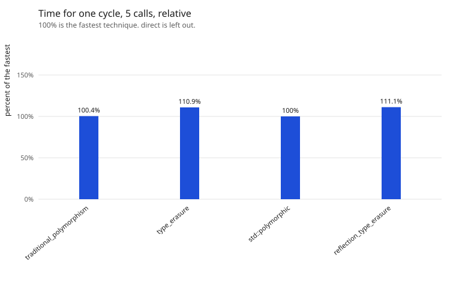

## Cycle, 50 calls

Construct, alternate draw() and area() fifty times, and destroy.

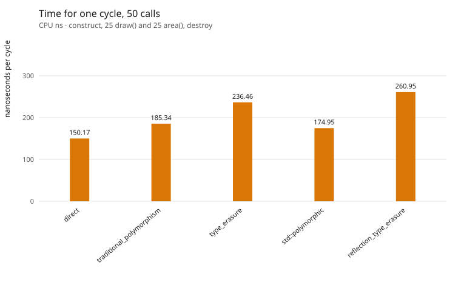

The chart below leaves out direct. 100% is the fastest of the four, and the others are that time scaled up.

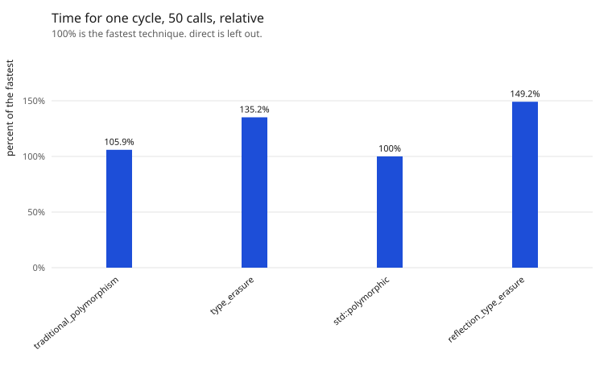

## Cycle, 500 calls

Construct, alternate draw() and area() five hundred times, and destroy.

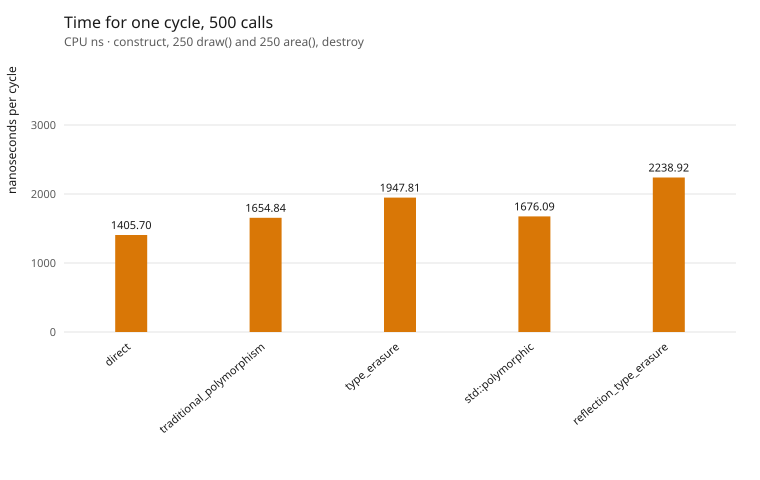

The chart below leaves out direct. 100% is the fastest of the four, and the others are that time scaled up.

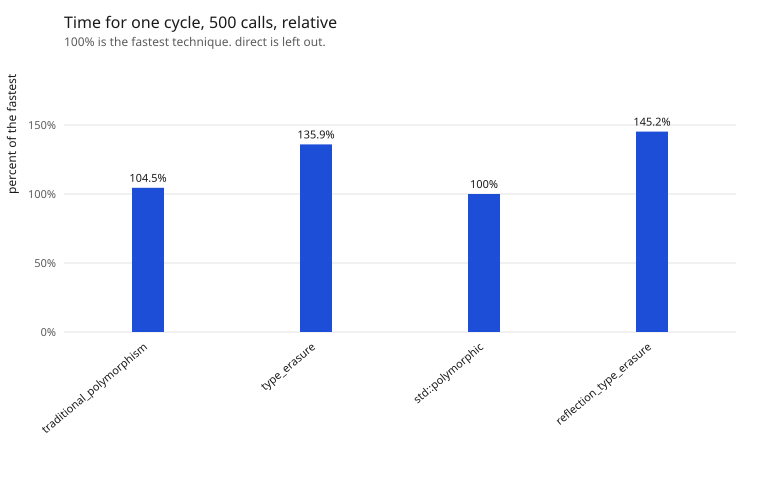

## Cycle, 5000 calls

Construct, alternate draw() and area() five thousand times, and destroy.

The chart below leaves out direct. 100% is the fastest of the four, and the others are that time scaled up.

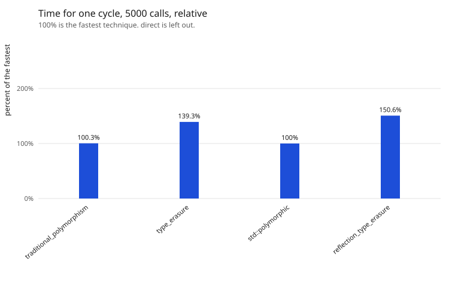

## Draw

One draw() call. The string fits in the small buffer.

The chart below leaves out direct. 100% is the fastest of the four, and the others are that time scaled up.

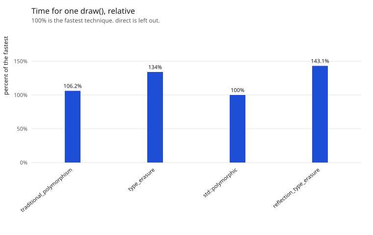

## Area

One area() call. traditional_polymorphism, type_erasure, and std::polymorphic use a local base because the shapes hierarchy has no numeric method.

The chart below leaves out direct. 100% is the fastest of the four, and the others are that time scaled up.

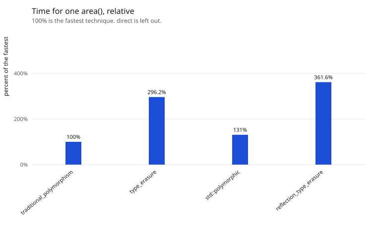

## Copy

Copy one owning object. traditional_polymorphism clones through a virtual function because unique_ptr does not copy the derived object.

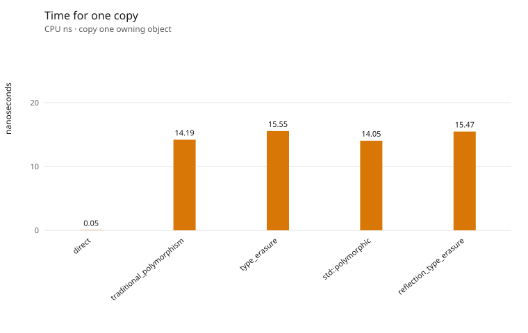

The chart below leaves out direct. 100% is the fastest of the four, and the others are that time scaled up.

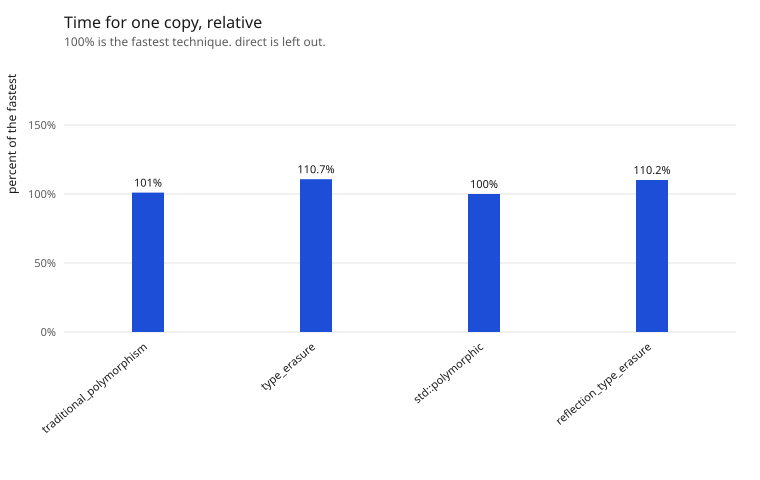

## Build

Construct one object. direct stores it in the array; the others allocate on the heap.

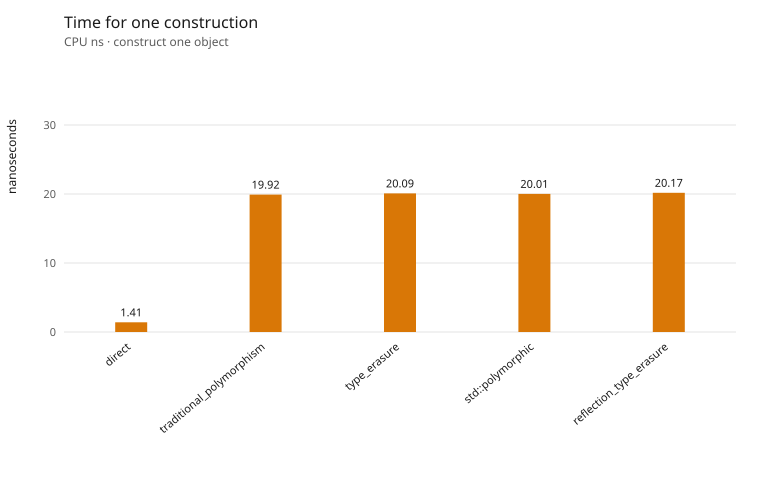

The chart below leaves out direct. 100% is the fastest of the four, and the others are that time scaled up.

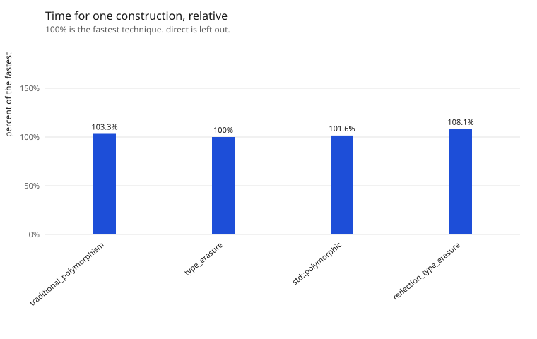
