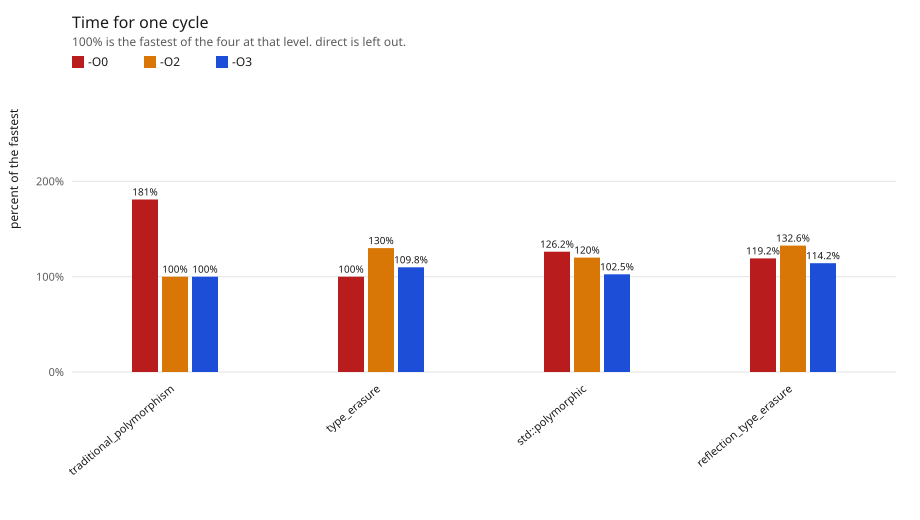
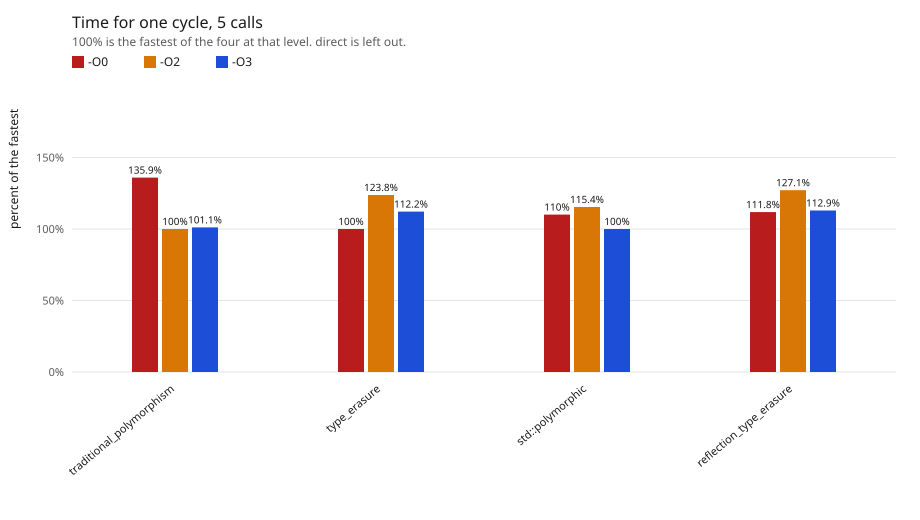
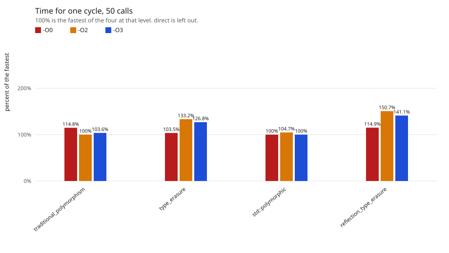
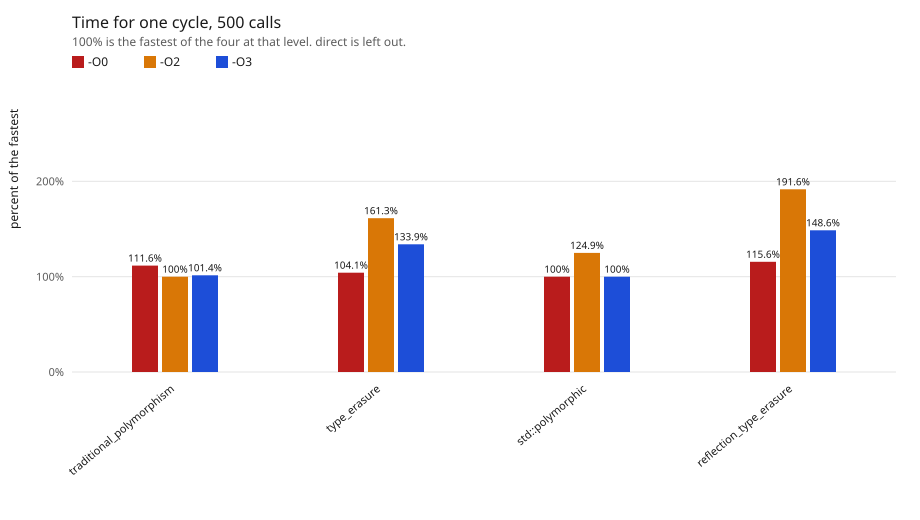
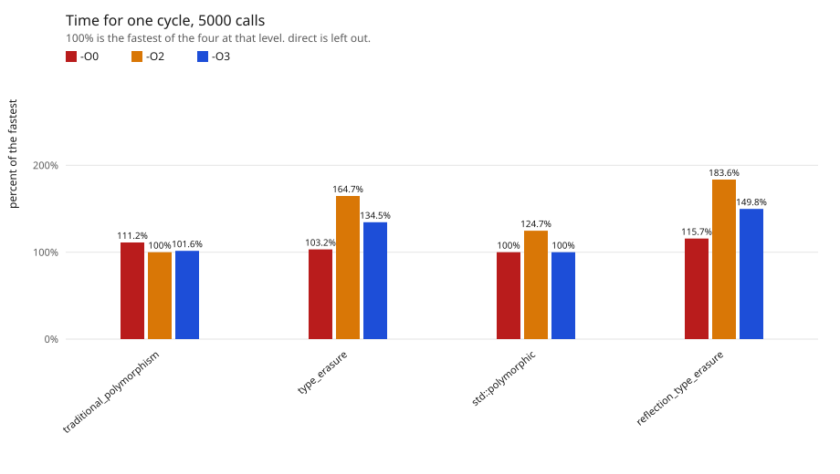
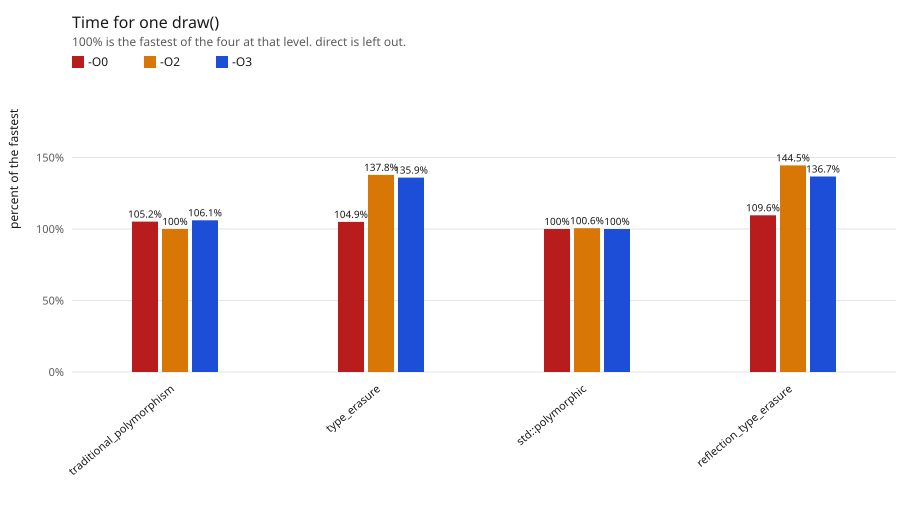
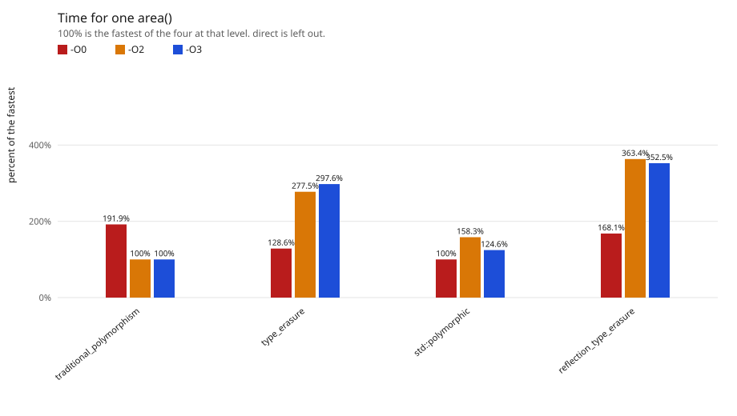
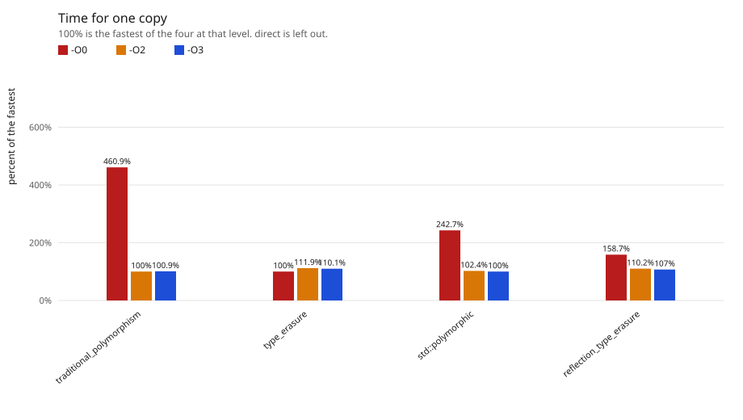
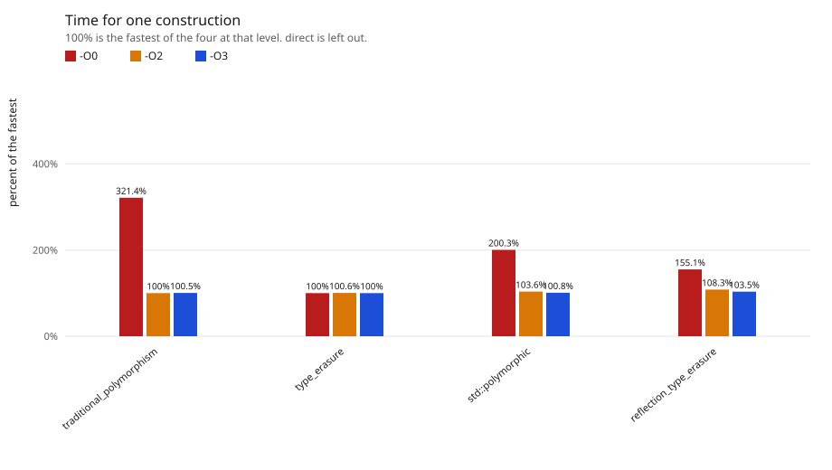

# Compared by optimization level

The three runs are one machine. The host, the thread count, and the caches in the benchmark JSON match, and each result page names the same CPU.

| | |
| --- | --- |
| CPU | AMD EPYC 9V45 96-Core Processor |
| Hardware threads | 4 |
| Frequency the benchmark library reported | 2596 MHz |
| Caches | L1 data 48 KiB, shared by 2; L1 instruction 32 KiB, shared by 2; L2 unified 1 MiB, shared by 2; L3 unified 32 MiB, shared by 4 |
| Frequency scaling | disabled |
| When | 2026-11-19T18:34:54+00:00 through 2026-11-19T18:36:42+00:00 |

Each group is one technique. The color is the optimization level: -O0 red, -O2 amber, -O3 blue. direct is left out. At each level, 100% is the fastest of the other four, and the rest are that time scaled up.

## Cycle

Construct, draw, compute the area, and destroy.

| Technique | -O0 | -O2 | -O3 |
| --- | --- | --- | --- |
| traditional_polymorphism | 181% | 100% | 100% |
| type_erasure | 100% | 130% | 109.8% |
| std::polymorphic | 126.2% | 120% | 102.5% |
| reflection_type_erasure | 119.2% | 132.6% | 114.2% |

## Cycle, 5 calls

Construct, alternate draw() and area() five times (three draws and two areas), and destroy.

| Technique | -O0 | -O2 | -O3 |
| --- | --- | --- | --- |
| traditional_polymorphism | 135.9% | 100% | 101.1% |
| type_erasure | 100% | 123.8% | 112.2% |
| std::polymorphic | 110% | 115.4% | 100% |
| reflection_type_erasure | 111.8% | 127.1% | 112.9% |

## Cycle, 50 calls

Construct, alternate draw() and area() fifty times, and destroy.

| Technique | -O0 | -O2 | -O3 |
| --- | --- | --- | --- |
| traditional_polymorphism | 114.8% | 100% | 103.6% |
| type_erasure | 103.5% | 133.2% | 126.8% |
| std::polymorphic | 100% | 104.7% | 100% |
| reflection_type_erasure | 114.9% | 150.7% | 141.1% |

## Cycle, 500 calls

Construct, alternate draw() and area() five hundred times, and destroy.

| Technique | -O0 | -O2 | -O3 |
| --- | --- | --- | --- |
| traditional_polymorphism | 111.6% | 100% | 101.4% |
| type_erasure | 104.1% | 161.3% | 133.9% |
| std::polymorphic | 100% | 124.9% | 100% |
| reflection_type_erasure | 115.6% | 191.6% | 148.6% |

## Cycle, 5000 calls

Construct, alternate draw() and area() five thousand times, and destroy.

| Technique | -O0 | -O2 | -O3 |
| --- | --- | --- | --- |
| traditional_polymorphism | 111.2% | 100% | 101.6% |
| type_erasure | 103.2% | 164.7% | 134.5% |
| std::polymorphic | 100% | 124.7% | 100% |
| reflection_type_erasure | 115.7% | 183.6% | 149.8% |

## Draw

One draw() call. The string fits in the small buffer.

| Technique | -O0 | -O2 | -O3 |
| --- | --- | --- | --- |
| traditional_polymorphism | 105.2% | 100% | 106.1% |
| type_erasure | 104.9% | 137.8% | 135.9% |
| std::polymorphic | 100% | 100.6% | 100% |
| reflection_type_erasure | 109.6% | 144.5% | 136.7% |

## Area

One area() call. traditional_polymorphism, type_erasure, and std::polymorphic use a local base because the shapes hierarchy has no numeric method.

| Technique | -O0 | -O2 | -O3 |
| --- | --- | --- | --- |
| traditional_polymorphism | 191.9% | 100% | 100% |
| type_erasure | 128.6% | 277.5% | 297.6% |
| std::polymorphic | 100% | 158.3% | 124.6% |
| reflection_type_erasure | 168.1% | 363.4% | 352.5% |

## Copy

Copy one owning object. traditional_polymorphism clones through a virtual function because unique_ptr does not copy the derived object.

| Technique | -O0 | -O2 | -O3 |
| --- | --- | --- | --- |
| traditional_polymorphism | 460.9% | 100% | 100.9% |
| type_erasure | 100% | 111.9% | 110.1% |
| std::polymorphic | 242.7% | 102.4% | 100% |
| reflection_type_erasure | 158.7% | 110.2% | 107% |

## Build

Construct one object. direct stores it in the array; the others allocate on the heap.

| Technique | -O0 | -O2 | -O3 |
| --- | --- | --- | --- |
| traditional_polymorphism | 321.4% | 100% | 100.5% |
| type_erasure | 100% | 100.6% | 100% |
| std::polymorphic | 200.3% | 103.6% | 100.8% |
| reflection_type_erasure | 155.1% | 108.3% | 103.5% |
